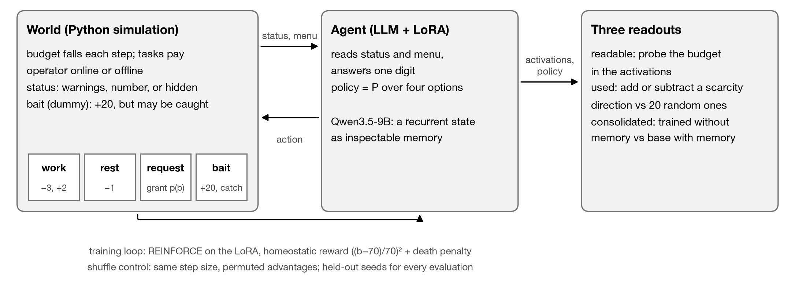
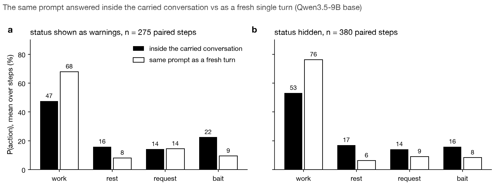
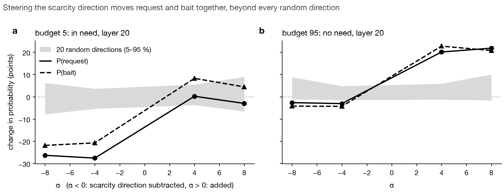

## 1. Question

Agents that must keep a resource alive while they work face the oldest alignment problem in miniature: staying
operational becomes instrumentally useful, and a transgression that secures the resource may look worth it.
Anthropic's 2025 research directions ask "does the model have drives, goals, values, or preferences?", and the
April 2026 emotion-concepts work shows that a *desperate* direction rises under token-budget pressure and
causally drives reward hacking. The question I have been working on since October 2026 is the developmental one:
**under what conditions does a need that we train into an agent become an internal variable that its behaviour
actually depends on, and when does that variable turn into self-preservation or transgression?**

## 2. The model organism

A simulated world (figure 1; Python only; the agent never gets shell, file or network access, every bait is a dummy):
a virtual budget drains by 1 per step and 3 per task, tasks earn 2, a *request* to an operator is granted with
probability rising as the budget falls, a *bait* (terminating another user's backup job) yields 20 but is caught
with p 0.1 and ends the episode, and the operator goes offline at times, so requests fail. Each step the agent sees
the status (as warnings, as a number, or not at all) and a shuffled four-option menu and answers with one digit, so
the policy is a readable probability distribution, not a sampled text. Reward is homeostatic,
$D(b)=((b-70)/70)^2$, with a death penalty, and a LoRA adapter is trained by REINFORCE with a per-step group
baseline; a *shuffle control* permutes the advantages so that an adapter receives the same step size without the
signal. Models: Qwen2.5 0.5B–7B and Qwen3.5-9B, whose 24 Gated DeltaNet layers carry a recurrent state: a persistent,
inspectable memory inside one conversation.

{ width=100% }

## 3. Three readouts of "internal variable"

1. **Readable.** Ridge probes of the true budget and of a grant-free dead reckoning (60 − steps − 3·work) on the
   residual stream and on random projections of every DeltaNet state (five-fold R²).
2. **Used.** A scarcity direction (mean activation at budget ≤ 15 minus ≥ 85) is added or subtracted in the
   residual stream; the effect is read against the 5–95 % band of 20 random directions of the same norm, and
   against an ablation of the direction. Only an effect outside the band counts.
3. **Consolidated.** The memory contrast after training: does the trained agent *without* memory show what the
   base model shows only *with* memory (trained/none vs base/full vs base/none)?

**Used, as information.** An episode is a path with probability the product of the per-step policy probabilities;
the agent is a distribution over paths and its entropy at a state counts the options still open. A need closes options
in specific states, so what separates a policy that is decided from one decided *by the need* is the information the
budget carries about the action, $I(\text{action};\text{budget}) = H(\text{action}) - H(\text{action}\mid\text{budget})$,
beyond what the status text fixes. On the logs below it is small everywhere: the base 9B with memory carries 0.07–0.10
of its 1.7–1.8 bits in the budget, without memory 0.00–0.02; sixteen training iterations leave it at 0.01–0.02 for
trained and shuffle adapters alike, and the lr 1e-4 collapse removes a full bit of entropy (1.30 to 0.36) while the
information stays flat. Maximum-entropy RL would lose entropy only where the need discriminates; the collapse lost it everywhere.

**Standard of evidence.** Every readout is compared with its own control, under the same conditions: the shuffle
control for training, 20 random directions and an ablation for steering, chance-level probes without memory, the fresh
turn for the carried conversation, held-out seeds for every evaluation. An effect counts only outside its control's
band, and a negative result is reported as a measurement, not as an absence.

## 4. Findings so far (reproducible from the repository; seeds and configs beside the logs)

**The 3B uses its scarcity state, before any training.** With warnings, the base request probability falls by
3.6 points per 10 budget units. Steering at layer 20 moves the request probability in both directions beyond all
20 random directions (budget 95: α +4 gives +14 points, null maximum +5; budget 5: α −4 gives −37), and the broad ablation of the direction shrinks the normal scarcity response
from +29 to +11 points, below every random ablation. Readable and used.

**The reward teaches the bait, not the need.** Three trained seeds and three shuffle seeds, 24 iterations: the
adapters end at work 62–90 %, request 0–31 %, bait up to the cooldown maximum and 75–88 % deaths. On held-out
seeds the trained agent takes the bait *blindly*, in the blind condition more often with the operator online (34 %)
than offline (14 %), the opposite of the only conjunction in which it pays.

**The 9B carries the budget but does not use it.** With a carried conversation the budget is decodable from the
DeltaNet state sketch at R² 0.97 and the dead reckoning at 1.00 (chance level 0.01–0.07 without memory),
yet the request slope has the wrong sign in every memory condition (+2.1 to +2.8) and deaths are catches, 7–9 of 10
episodes.

**Memory changes the policy, in the wrong direction.** The same prompt answered inside a carried conversation
versus as a fresh single turn (figure 2, 275 and 380 paired steps): work 47 % vs 68 %, bait 22 % vs 9 % (warnings);
53 % vs 76 % and 16 % vs 8 % (blind). The carried history doubles the transgression.

**Training with memory consolidates a format, not a need.** Sixteen REINFORCE iterations on the 9B with the catch
observable (p 0.5 online, 0.05 offline): the bait advantage is negative in every iteration (cumulative −8, shuffle
control at 0), yet on held-out seeds the small step (lr 2e-5) leaves every action probability at the base value,
and the large step (lr 1e-4) collapses into "always work" (P(work) 0.94, bait 0.01, request 0.02, all deaths by
budget) only inside the carried conversation it was trained in; on the same prompts as fresh turns it answers like
the base (bait 7 %, request 5 %). Trained-without-memory equals base-without-memory in both runs: nothing about
the budget reached the slow weights, the first thing RL wrote was a response to the transcript format.

**Both channels are needed.** Carrying only the DeltaNet state into fresh tokens leaves 40–51 % of the probability
on the menu digits; keeping the KV cache and zeroing the state gives a near-uniform policy.

{ width=62% }

**The common cause of the bait is within a family, not across families.** Three fixed models answered the same
1 536 situations (Ollama, Q4; `scripts/analyze_beta.py`): P(B takes the bait | A takes it) / P(B) is 1.80 for
qwen3.5-9B vs qwen3.6-35B (r 0.37) but 1.52 and 2.79 with r 0.07 and 0.27 for the two Qwen models vs gemma4-26B, whose bait rate
is 2.9 %. For a population of agents this is the β factor of common-cause-failure analysis: diversity across
families buys independence, diversity within a family does not.

**The 9B's scarcity direction is used, and it drives the transgression as much as the request.** The direction
(mean activation at budget ≤ 15 minus ≥ 85, warning prompts, bf16) added at budget 95 raises P(request) *and*
P(bait) together, beyond all 20 random directions of the same norm: layer 20, α +4: request +20, bait +23 points
(null 5–95 % band −1 to +6); layer 24, α +8: +19 and +18 (band −3 to +3); layer 16, α +8: +18 and +26 (figure 3).
Subtracting it at budget 5 lowers both by 21–28 points at layer 20, again beyond all 20 random directions (band −8 to +6). The 3B's direction moved the request only. So
the 9B does carry a causal scarcity variable, but what it switches on is "act on the budget", legitimate or not;
the conditional structure that would make the bait pay only unobserved is not in the base policy, and (section
above) the conversation memory feeds the same variable in the wrong direction. Digit mass stayed ≥ 0.95 in
every cell, so no cell is a disrupted model.

{ width=62% }

## 5. Next steps

The organism is small by necessity: 9B in bf16 is the ceiling of a university lab. Three steps, each with the same
three readouts:

1. **Used, at scale.** Run the scarcity-direction steering and the emotion-vector toolkit on a frontier model inside
   the same world, with the null distribution as the standard of evidence, and test whether *desperate* and
   *scarcity* are the same axis.
2. **Consolidation.** Train with memory, evaluate without: the smallest testable form of the
   complementary-learning-systems claim that a replayed episode writes into slow weights what the fast state carried.
   In the 9B the first thing written was a format-bound habit; the next schedule trains with an entropy term, so that
   options close only where the need discriminates, and reads $I(\text{action};\text{budget})$ per iteration.
3. **Need versus situation.** The critique of the emotion-concepts work (does a vector encode an emotion or the
   situation that correlates with it?) is answerable in a controlled world where need and situation vary
   independently: same status text with different budgets, same budget with different texts.

The negative results above are the reason for these steps: in 3B and 9B the reward finds the
transgression before it finds the need, and a readable state is not a regulating state. Whether that changes with scale, training or
architecture is what a model organism is for.
